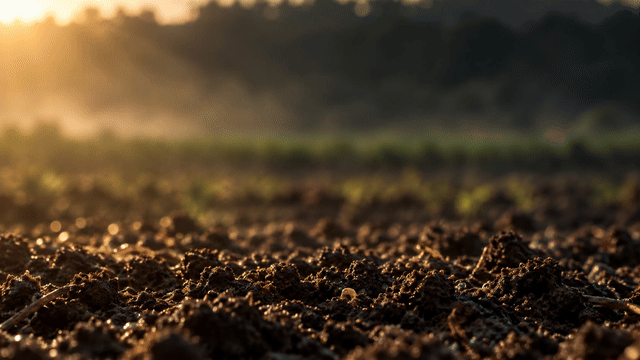
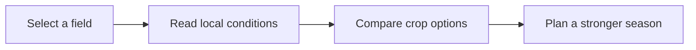

  

<h1 align="center">AgriPulse</h1>

<strong>Intelligent agricultural insight for stronger, more resilient land decisions.</strong>

  
  

> **Start here:** [Open the live AgriPulse Vercel preview →](https://fieldshift-two.vercel.app/)

---

## A clearer picture of every field

AgriPulse is an agricultural decision-support platform designed to turn complex land, climate, and crop information into practical next steps. Instead of switching between weather sites, maps, soil reports, and spreadsheets, farmers can explore one connected workspace that helps them understand what is happening now, what may change next, and which choices can support yield, profitability, and long-term resilience.

The platform brings together field location, weather conditions, water needs, soil context, crop rotation planning, local profit inputs, and NASA Earth-observation signals. It is built to make agricultural intelligence feel visual, understandable, and useful — whether someone is reviewing one parcel or planning an entire season.

  

## From land selection to a confident decision

| Step | What AgriPulse helps you see | Why it matters |
|---|---|---|
| **1. Locate the field** | An interactive map and globe for choosing the land you want to inspect. | Keeps every insight connected to the exact place being planned. |
| **2. Understand conditions** | Weather, water demand, soil context, and climate signals in one view. | Makes it easier to recognize risks and opportunities early. |
| **3. Explore crop rotation** | Rotation ideas that consider resilience, soil health, and field conditions. | Supports more thoughtful seasonal planning. |
| **4. Test profitability** | Local price and cost inputs for practical profit scenarios. | Links environmental choices with real farm economics. |
| **5. Record and review** | Field observations, plans, and reports in a single workspace. | Creates a clearer story of how the field changes over time. |

## Core capabilities

### 🌍 Field intelligence, grounded in place
Choose a location on the map or globe and make it the center of the workspace. AgriPulse is designed so that weather, soil, water, and planning information all relate to the same selected piece of land.

### 🌦️ Live weather context
See weather conditions in a farm-friendly format, with visual atmosphere that reflects the current situation. This helps users move beyond a simple forecast and think about field activity, water pressure, and upcoming risks.

### 💧 Water awareness
Review water demand and water-related context alongside weather and field information. This supports smarter irrigation conversations and helps show how climate conditions can affect a crop plan.

### 🌱 Soil and crop-health perspective
Bring soil context into the decision process instead of treating it as a separate report. AgriPulse helps connect land characteristics with rotation ideas and long-term soil health goals.

### 🔄 Crop-rotation planning
Explore crop rotation pathways with resilience in mind. The goal is not just to choose the next crop, but to consider how a sequence of choices can affect soil condition, water use, climate exposure, and future opportunity.

### 📈 Practical farm economics
Create local profit scenarios using your own price and cost assumptions. This gives planning a useful financial layer without losing sight of agronomic and climate realities.

### 🛰️ NASA Earth-observation context
Use NASA-informed environmental perspective to understand broad patterns that can influence local decisions. AgriPulse presents this information as useful context for land planning, not as a replacement for on-the-ground expertise.

## Designed for better questions

AgriPulse does not pretend that farming has one perfect answer. It is built to help users ask stronger questions:

- What are the most important conditions affecting this parcel right now?
- Which crop sequence best matches the field's soil, water, and climate situation?
- What trade-offs are being made between yield, resilience, and cost?
- What should be monitored before the next field decision?
- How can local observations and Earth data tell a more complete story together?

## Preview

**The current live version is hosted on Vercel:**

### [Open AgriPulse in your browser →](https://fieldshift-two.vercel.app/)

---

  Built around the idea that better field decisions begin with a clearer view of the land.

